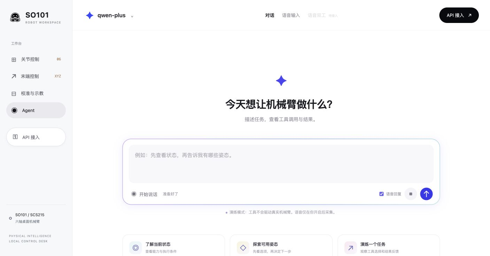

# 上位机 Agent

2026-10-24。Agent 嵌入机械臂上位机；文字和语音是同一 Agent 的交互模式，
共用 AgentSession、prompt、OpenAI 标准工具与停止机制。当前技能全部 dry-run。
无需连接机械臂即可对话。腕部相机、跟踪/IK 工具与 Agent 实物执行尚未接入。



## 模型怎么选

课程联调默认使用百炼北京免费额度：聊天 `qwen-plus`（非思考）、
识别 `qwen-audio-3.1-asr-flash-message`、合成 `qwen-audio-3.1-tts-flash`。
真实调用前逐模型确认余量、有效期并启用平台「免费额度用完即停」；当前程序不读取余额或代开该开关。
额度不足时停止调用，不自动转付费。具体参数、用量安排及候选模型验收见
[模型与免费额度建议](agent_models.md)。

## 一键启动与页面配置

使用项目 Python 3.12 与 uv；云语音 SDK 为可选依赖，不需要端侧模型或 Conda：

```sh
uv run --locked --extra speech python scripts/arm_desk.py --http-port 8765
```

打开终端打印的 `http://127.0.0.1:8765/#agent`，选择「Agent」，点击右上角「API 接入」。
不需要创建 TOML 或 .env 文件。端口被占用时换一个端口，或用 `--http-port 0` 自动分配。

| 页面配置 | 内容 |
|---|---|
| 聊天与工具 | 服务预设、Chat Completions / Responses 协议、Base URL、模型 ID、API Key |
| 请求参数（展开） | token 限额字段、超时、model_options 和 extra_body JSON |
| 语音识别 ASR（可选） | DashScope 原生 WebSocket URL、识别模型 ID、Key、超时 |
| 语音合成 TTS（可选） | DashScope 原生 WebSocket URL、合成模型 ID、音色 ID、Key、超时 |

聊天预设包括千问/百炼、DeepSeek、Kimi、MiniMax、OpenAI，也可填写其他兼容服务。
预设是地址与协议默认值，不代表每个供应商的每个模型都已真实验收；能力取决于选定模型。
ASR/TTS 当前只有官方 DashScope SDK 适配，可分别使用不同账号/Key。
本轮已验证 `qwen-plus`、`qwen-audio-3.1-asr-flash-message`、
`qwen-audio-3.1-tts-flash` 和音色 `longanhuan_v3.1`。
语音 URL 与聊天 compatible-mode URL 不同；从服务平台取得所属区域/业务空间地址，不能混用。

点击「保存并使用」会验证配置并开始新对话，第一次发送才请求模型。
已有 Key 留空可保留；改变服务或地址时必须重新填写 Key，避免把旧凭据带给其他服务。
失败配置不会替换当前可用配置；处理中的回合需先停止并等待排空。

网页配置只放在该浏览器会话对应的服务端内存，Key 不回显、不写文件、URL 或浏览器存储。
同一会话的标签页共享配置；独立浏览器会话各自隔离。刷新页面仍可使用当前会话；
「清除本次配置」或服务重启会清除该会话凭据；一小时没有 Agent API 访问的会话在后续访问时惰性回收。
页面打开时会持续轮询，不应把它当作已空闲；离开前可显式清除。
会话最多 16 个。浏览器会话 cookie 为 HttpOnly / SameSite=Strict；关闭浏览器不会通知服务端立刻回收。
若启动时显式使用下述文件预配置选项，新浏览器会话会继承操作者提供的初始配置。

当前上位机只绑定本机 loopback，这是本地使用链接，尚未部署公网服务。
将来托管部署应复用同一页面配置契约，另补部署鉴权、TLS 与租户权限；不能直接把该硬件上位机暴露公网。

## 怎么交流

1. 输入文字并发送；Enter 发送、Shift+Enter 换行。例如「先查看状态，再列出可用姿态」。
2. 选择「语音输入」或点击「开始说话」，允许本站麦克风权限，再点击「结束并发送」。
   切换工作台页面、隐藏标签页或停止时取消录音；每段最长约 29 秒。
3. 「语音回复」开启时播放 TTS；浏览器阻止自动播放时点击播放器。没有 TTS 也能文字对话。
4. 输入区「停止本轮」取消录音、识别、推理与播报；已连接设备时同时请求原控制器停止。
   原有「释放扭矩 / 急停」也会取消所有 Agent 会话，真实设备停止仍以控制器反馈为准。

录音期间先停止播放；处理期间不接受新的普通输入，没有待重放队列。
切换配置或停止后，旧输入、迟到 ASR、模型结果和音频不能重新生效。
「语音双工」明确标为待接入，当前是按回合录音上传，不是持续监听、实时转写或全双工 Omni。
语音停止仍要经过云识别，有网络延迟；本地停止按钮独立于云端。

浏览器将音频转换为 mono / 16-bit / 16kHz PCM WAV，服务端再次检查格式和时长。
只有最终转写进入工具循环。录音和模型输入会传给你选择的云服务。
音频最长 30 秒；TTS 每次最多 1000 字符，超限保留文字并报告合成错误。
TTS 失败不重跑模型或重复工具。页面与 API 只返回配置元数据和 Key 是否设置，不返回 Key。

## 模块边界

| 模块 | 职责 |
|---|---|
| `policy/model_io` | 标准模型协议、消息、流式与凭据解析 |
| `policy/agents` | 工具循环、状态、事件、取消与有界上下文 |
| `applications/agent/speech.py` | 云语音契约、WAV 校验、期限和本地取消 |
| `applications/agent/_dashscope_speech.py` | 官方 DashScope SDK 薄适配 |
| `applications/desktop/agent.py` | 同一 Agent 的文字/语音回合、消息与音频代次 |
| `applications/desktop/agent_config.py` | 内存配置、原子替换、浏览器会话与凭据隔离 |
| `applications/desktop/assets/agent-settings.js` | 独立配置表单，不负责机器人控制或密钥持久化 |
| `applications/desktop/assets/agent.js` | 输入、主动录音、采样转换、播放与停止 |

原生 SDK 存在全局 Key/URL 和阻塞方法，每次语音调用在独立 spawn 进程运行。
凭据只在内存传递，不进入命令行或临时配置；取消/超时后终止并回收本地工作进程。
本地取消不保证远端立刻停止计算或计费。SDK 原始错误不透传，不自动重试或切换服务。
端侧识别仍可通过 stdin 提供文本，与云语音解耦，没有其他本机项目或目录依赖。

## 可选 CLI 与文件验收

批处理或操作者预配置仍兼容显式文件，网页使用不依赖这些文件。
聊天文件生成见[多服务配置指南](agent_providers.md)；语音复制
`configs/agent/speech.example.toml` 并填写自己的业务空间、模型与凭据环境变量名。
Key 放在所选环境变量或被 Git 忽略的本机 .env；不提交凭据。显式 .env 不插值、不搜索其他目录。

```sh
# 可选：用操作者文件预配置新浏览器会话
uv run --locked --extra speech python scripts/arm_desk.py --http-port 8765 \
  --agent-config configs/agent/provider.local.toml --agent-env-file configs/agent/.env.local \
  --speech-config configs/agent/speech.local.toml --speech-env-file configs/agent/.env.local

# 只检查文件配置与凭据，无网络
uv run --locked --extra speech eai-course speech --config configs/agent/speech.local.toml \
  --env-file configs/agent/.env.local check

# 固定短句真实 TTS → ASR，最多三轮，新输出目录，拒绝覆盖
uv run --locked --extra speech eai-course speech --config configs/agent/speech.local.toml \
  --env-file configs/agent/.env.local probe --rounds 3 --output-dir outputs/speech-check-001
```

另有 `tts --text TEXT --output FILE.wav` 与 `asr --audio FILE.wav`，显式选择文件才上传。
已有 Conda 环境的操作见下文；依赖仍由同一锁文件管理，不要求使用 uv 的合作者安装 Conda。

真实测试记录见[云语音报告](reports/2026-10-24-cloud-speech.md)和
[Windows 麦克风与停止人工验收](reports/2026-10-24-windows-agent-microphone.md)。单次真实麦克风链路通过
不代表噪声/回声覆盖、相机理解、真实双工或实物任务验收。音频和本机完整日志不提交。


## 新协作者从零接入

### 选择正确源码

以 PR 合并状态为准。本功能在 [PR #25](https://github.com/EAI-Course-2026/eai_project/pull/25)
评审中时，`main` / `develop` 不一定包含本指南所述界面。在评审用独立 checkout 执行：

```sh
git fetch origin
git switch --track origin/codex/integration-cloud-speech
```

已有同名本地分支则使用 `git switch codex/integration-cloud-speech`。不在有未提交工作的 checkout
强行切换，不使用 reset/clean。PR 合并后从最新 develop 新建自己的任务分支，不继续堆到旧功能分支。
环境与版本固定为 Python 3.12、uv 0.11.7；安装器见[环境指南](environments.md)。

### macOS / Linux 与 Windows

在仓库根目录运行前文一条启动命令即可由 uv 安装并运行可选语音依赖。
Windows PowerShell 的命令相同；如中文日志乱码，先执行：

```powershell
$env:PYTHONUTF8 = '1'
$env:PYTHONIOENCODING = 'utf-8'
uv run --locked --extra speech python scripts/arm_desk.py --http-port 8765
```

`--no-open` 只禁止自动打开浏览器，不禁用 Web 服务。服务必须在使用期间保持运行。
结束时在启动终端 Ctrl+C；页面不能代替服务进程。用户关闭浏览器并不等于服务退出。
已有一般控制环境可先执行 `uv sync --locked --extra speech`，后续运行仍带 `--extra speech`，
避免普通 locked sync 移除该可选依赖。只用文字 Agent 不需要 DashScope SDK。

### 使用既有 Conda 的协作者

这是兼容入口，不要求团队切换到 Conda，也不在不需要 Conda 的机器安装它。
在合作者自己的 Conda 终端执行已有 bootstrap：

```sh
python scripts/setup_conda.py --name eai-control
conda activate eai-control
```

已创建的专用环境用 `--reuse`，不要复用 base 或混用训练环境。
若需要云语音，在激活后执行以下跨平台命令，让 uv 在**本次子进程**同步到该 Conda 前缀：

```sh
python -c "import os,sys,subprocess; subprocess.run([sys.executable,'-m','uv','sync','--locked','--inexact','--no-managed-python','--python',sys.executable,'--extra','speech'],env={**os.environ,'UV_PROJECT_ENVIRONMENT':sys.prefix},check=True)"
python scripts/arm_desk.py --http-port 8765
```

`--inexact` 保留 Conda/pip/uv 引导包；项目依赖版本仍取自根 uv.lock。
不要在激活 Conda 后直接用普通 `uv run` 猜测目标环境；它默认仍选择项目 `.venv`。
完整故障处理见[Conda 说明](environments.md#conda-quick-start)。本轮本机没有安装 Conda；兼容入口由托管 CI 检查。

## 页面填写示例与请求边界

### 最小文字配置

启用「聊天与工具」，选择服务预设，填写服务实际支持工具调用的模型 ID 和 Key。
默认协议为 Chat Completions；只有服务明确支持 Responses 时才选择它。
Base URL 是 SDK 根地址，例如百炼北京常规接入为
`https://dashscope.aliyuncs.com/compatible-mode/v1`，不在后面重复添加 `/chat/completions`。
业务空间专属地址以自己的控制台配置为准；不要复制其他账号的地址或把 Key 放进 URL。

只启用聊天即可保存、发送「先查看状态，再列出可用姿态」。
成功应看到 `get_robot_state` 和 `list_poses` 的 simulated 结果，再出现自然语言回答。
这证明外部模型选择了工具；`--demo` 的固定 fixture 不能代替此证据。

### 添加云 ASR / TTS

分别勾选 ASR 与 TTS，两处 URL 和 Key 都是独立配置。
百炼本轮原生接入的 URL 形态为：

```text
wss://YOUR_WORKSPACE_ID.cn-beijing.maas.aliyuncs.com/api-ws/v1/inference
```

把占位符换成自己的业务空间 ID，不带引号，不混入 HTTP compatible-mode 路径。
填写前文已经实测的模型/音色组合，确认它们在自己的区域和账户可用。
仅启用 ASR 时语音输入后只回文字；仅启用 TTS 时仍用文字输入并播放回答。
没有聊天配置时，媒体配置本身不会变成可对话的 Agent。

本轮只验证北京这组模型与 SDK。其他区域、音色、旧版 CosyVoice/Paraformer、OpenAI Audio API
以及其他厂商的 ASR/TTS **没有通用兼容保证**；改模型名不能替代协议适配和真实验收。
扩展接口见[开发交接](agent_handoff.md)。

### 调整请求参数

先保持默认，遇到模型兼容问题时再逐项调整：

| 参数 | 用途与注意点 |
|---|---|
| `max_tokens` / `max_completion_tokens` | 选择服务接受的字段；当前页面输出上限 1–8192 |
| `timeout_s` | 聊天 0.1–120 秒，语音 1–120 秒；不能替代核心回合或运动期限 |
| `model_options` | SDK 标准选项，如 temperature；后端按允许集合校验 |
| `extra_body` | 显式厂商扩展，例如本轮千问 `{"enable_thinking": false}` |
| `streaming` | 页面启用流式模型响应；浏览器通过状态轮询显示增量，不是浏览器 WebSocket 音频流 |

厂商扩展不能覆盖 model、messages、tools、路由、凭据、输出预算或服务端会话状态。
选择预设只填地址和参数默认值，不自动调用计费 API。保存成功也只表示本地配置有效；
认证、区域、模型能力和账户额度要由首个真实请求确认。不会静默换服务或重试机器人动作。

## 五分钟验收清单

在没有连接机械臂的情况下顺序操作，并把结论分开记录：

| 步骤 | 操作 | 预期 |
|---|---|---|
| 1 | 无参数启动，上位机进入 Agent | 有 API 配置入口；未设置时不能发送 |
| 2 | 只配置聊天，保存 | 模型名更新，新对话，没有保存配置时的外部调用 |
| 3 | 查询状态和可用姿态 | 真实 LLM 工具调用，结果明确 simulated / 无硬件反馈 |
| 4 | 配 ASR，说一句状态查询并结束录音 | 最终转写成为用户消息，再进入同一工具循环 |
| 5 | 配 TTS 并勾选语音回复 | 文字仍保留，播放器可播，失败不会重复工具 |
| 6 | 处理中点停止 | 本轮旧结果不再提交，旧音频不可重新获取 |
| 7 | 留空保留已有 Key 并保存；再改服务但不填新 Key | 前者成功并换会话，后者拒绝并保留原配置 |
| 8 | 用独立浏览器会话或隐私窗口打开 | 默认不共享另一会话的 Key/聊天；显式操作者文件 seed 除外 |
| 9 | 清除配置后刷新 | 当前会话变为未配置；重新填写才能对话 |

首次麦克风测试要本人允许浏览器权限；离线 CI 和合成文件测试不验证真实麦克风。
「停止本轮」是独立的本地入口。不要用正常录音上传去替代实时紧急停止测试。
实物验收需另按机器人操作规程进行，本清单不授权启用电机。

## 常见问题

| 现象 / 错误 | 处理 |
|---|---|
| 仍看到旧界面 | 核对 checkout 分支、启动的终端和实际打印的端口，再刷新；不要假定另一个 worktree 的服务自动更新 |
| 发送灰色 | 先在 API 接入启用聊天；处理中和录音时普通发送互斥 |
| 麦克风灰色 | 除聊天外还需启用 ASR；浏览器需允许本站麦克风，当前仅本机安全上下文 |
| Key 留空无法换服务 | 新提供方/地址必须填对应 Key；旧 Key 不会自动转发到新地址 |
| `invalid_api_settings` | 检查 URL、模型、JSON、字段名和预算；失败更新不会覆盖旧配置 |
| `missing_credential` / 认证错误 | 检查该阶段 Key、区域和业务空间，聊天/ASR/TTS 分别配置 |
| `busy` / `tool_still_running` | 停止后等待本地 worker 排空，再显式重试；不要排队重放旧动作 |
| `stale_input` | 发送期间配置或代次已变；刷新当前状态后重新提出意图 |
| `speech_extra_required` | 用本指南带 `--extra speech` 的命令安装/运行；不要临时装另一套 SDK 版本 |
| `speech_timeout` / `speech_service_error` | 核对原生 URL、模型/音色和平台状态；错误已脱敏，界面不会返回供应商原始错误体 |
| `speech_rate_limited` / 限流 | 在平台核对额度/并发，降低请求频率；停止后再决定是否重试 |
| TTS 失败但有文字 | 保留并阅读文字；超过 1000 字符或 30 秒输出限制也会失败，不重跑本轮工具 |
| 没有自动播报 | 检查语音回复开关；浏览器阻止自动播放时点击播放器 |
| `session_limit` | 最多 16 个浏览器会话，关闭不用的页面并清除配置；无访问会话到期后惰性回收 |
| 服务连接中断 | 检查启动终端是否退出、端口是否改变；服务重启会丢失内存配置和聊天 |

报问题时提供分支/提交、操作步骤、模型 ID、错误码和大致时刻。
不提交 Key、cookie、完整工作空间 URL、原始录音或包含它们的 HAR/网络截图。
维护者需复现、扩展或优化时，从[开发交接](agent_handoff.md)继续。
